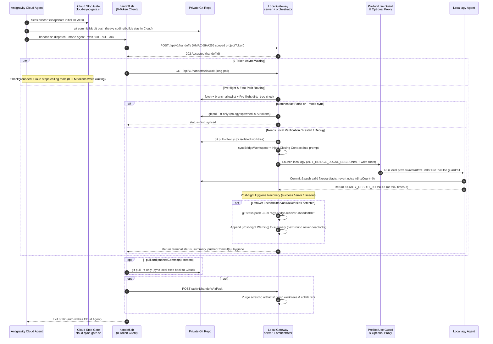

# `agy-cloud-bridge`

**English** | [简体中文](./README.zh-CN.md)

[](https://github.com/guaidashu/agy-cloud-bridge/actions/workflows/ci.yml)
[](./LICENSE)
[](https://nodejs.org/)
[](./package.json)

**A zero-dependency Cloud ⇄ Local [Antigravity (`agy`)](https://antigravity.google) collaboration gateway.**

Run heavy AI coding, repository indexing, dependency installs, builds, and tests inside **Antigravity Cloud** — and only wake your local machine (macOS / Linux) on demand for lightweight Git sync, live preview, service hot-reload, or local-only hardware/intranet debugging.

**Protect your laptop's soldered SSD from massive AI write wear (TBW), keep thermals & fans quiet, and extend your computer's lifespan — without giving up local preview and debugging.**

---

## Why Cloud ⇄ Local Saves Your SSD & Extends Laptop Lifespan

Running autonomous AI coding agents full-time on a personal laptop hammers the local SSD with tens of gigabytes of daily writes (dependency caches, `node_modules`/Cargo/Gradle/Docker layers, repeated full-repo indexing, build artifacts, browser captures, and temporary scratch files). On modern laptops with non-replaceable soldered SSDs, sustained write amplification directly shortens hardware life.

| Workload | Traditional Local-Only AI Agent | With `agy-cloud-bridge` (Cloud ⇄ Local) |
| :--- | :--- | :--- |
| **Heavy coding, refactoring & repo indexing** | Runs on local CPU + local SSD | **Runs in Antigravity Cloud sandbox** (0 local SSD wear) |
| **Dependency installs, compiles & unit tests** | Gigabytes written to local SSD every session | **Executed in Cloud**; local machine only pulls minimal Git commits |
| **Docs / content / static edits (`fastPaths`)** | Often triggers full agent + rebuild | **Zero-Token `git pull --ff-only`** (milliseconds, no AI woken up) |
| **Local preview / service restart / intranet DB** | Always local | **On-demand targeted handoff** with zero-token async waiting |
| **Temporary screenshots, logs & worktrees** | Scattered across workspace & SSD | Isolated in `runsDir` / `worktreesDir` (mountable to **`/tmp` or RAM Disk**) & **purged immediately on `--ack`** |
| **Dirty working tree & leftover cleanup** | Manual cleanup or broken next runs | **Pre-flight protects your edits** + **Post-flight auto-stashes AI leftovers** (`dirtyCount=0`) |

---

## Key Features

1. **SSD-Friendly Offload & Instant Artifact Cleanup**:
   - Point `runtime.runsDir` and `runtime.worktreesDir` to `/tmp` or a RAM Disk so ephemeral screenshots, logs, and temporary Git worktrees never touch your primary SSD.
   - Cloud `--ack` immediately purges run artifacts, temporary worktrees, and remote collaboration refs (plus a 24h automatic sweep).
2. **Zero-Token Async Waiting & Cloud Stop Gate**:
   - The dual-runtime (`python3` / `node`) `handoff.sh` client waits via HTTP long-polling or `git ls-remote` with **0 LLM tokens consumed while waiting**.
   - Built-in repo `Stop` hook (`cloud-sync-gate.sh`) prevents cloud agents from forgetting to push or trigger local deployment, while cleanly stepping aside when waiting asynchronously in the background.
3. **Dual-End Symmetric Hygiene & Anti-Deadlock Fallback**:
   - **Pre-flight**: Default `dirtyPolicy: "safe-block"` protects your manual uncommitted work on the local machine (`phase=dirty_tree`).
   - **Prompt Closing Contract**: Every local `agy` dispatch automatically appends a closing contract requiring the agent to check `git status --porcelain`, commit & push valid fixes/generated files (e.g. `.meta`, lockfiles, generated code), revert build noise, and assert `dirtyCount=0`.
   - **Post-flight Auto-Stash**: Whether local `agy` succeeds, errors out, or times out, any leftover uncommitted/untracked files are safely stashed via `git stash push -u -m "agy-bridge-leftover:<handoffId>"` (preserving gitignored `.agy-local` and pre-existing user WIP in unchanged peer repos) with a warning appended to `summary` — zero lost files and zero next-round `dirty_tree` deadlocks.
4. **Multi-Repo Group Coordination (`--group`)**:
   - Modify multiple sibling repos in Cloud, run **one** `handoff.sh dispatch`, and the gateway selectively syncs only changed repos, launches a single local `agy` with a multi-repo change manifest, and pulls cross-repo fixes back via `--pull`.
5. **Defense-in-Depth Security**:
   - Per-project scoped `HMAC-SHA256` tokens (`proj_...`) + 5-minute replay window + nonce deduplication.
   - Automatic GitHub public-repo detection on `enroll` to prevent accidental token exposure.
   - External workspace `PreToolUse` guardrail (`bridge/agy-bridge-guard.mjs`) blocking sensitive credential paths, env dumps, destructive commands, and unauthorized `git push`.
   - Optional **Fail-Closed Egress Proxy Isolation** (`agy.requireProxy = true` + custom launcher).
   - Automatic secret redaction (`src/redact.js`) across summaries, errors, and audit logs.
6. **Zero Dependencies & Cross-Platform**:
   - Pure Node.js 18+ standard library; works on macOS and Linux with zero `npm install` bloat.

---

## Architecture & Latest Workflow Sequence



---

## Choose Your Connection Mode (4 Options)

| Mode | Public Server / VPS Required? | Best For |
| :--- | :---: | :--- |
| **1. Serverless `git-ref` (`--channel git-ref`)** | **No** (GitHub private repo only) | Zero-cost personal setup, air-gapped networks, no tunnel needed |
| **2. Cloudflare Tunnel (`cloudflared`) / Tailscale Funnel / ngrok** | **No** (free managed HTTPS) | Fastest real-time HTTPS long-polling without renting a VPS |
| **3. FRP + Nginx** | Yes (self-hosted VPS) | Stable custom domain & full self-hosted control (`deploy/frp/`, `deploy/nginx/`) |
| **4. Optional Egress Proxy Isolation** | Works with all above | Corporate/isolated networks requiring Fail-Closed proxy routing (`deploy/proxy/`) |

---

## 5-Minute Quick Start

### Prerequisites

- **Local machine (macOS or Linux)**: Node.js `>= 18`, Git, and [Antigravity CLI (`agy`)](https://antigravity.google) installed locally.
- **Private Git repository** (e.g., private GitHub repo) accessible from both your local machine and Antigravity Cloud.

### Step 1: Clone & Initialize the Local Gateway

```bash
git clone https://github.com/guaidashu/agy-cloud-bridge.git
cd agy-cloud-bridge

# Initialize ~/.agy-bridge (creates config.json and chmod 600 secret.env)
node src/cli.js init

# Optional (Recommended for maximum SSD longevity):
# Offload ephemeral scratch runs & temporary worktrees to /tmp or a RAM Disk
node src/cli.js init \
  --runs-dir /tmp/agy-bridge/runs \
  --worktrees-dir /tmp/agy-bridge/worktrees
```

### Step 2: Expose Your Gateway (or Skip for Serverless `git-ref`)

- **Option A — Zero-Server (`git-ref`)**: Skip this step and pass `--channel git-ref` during `enroll` (automatically enables `gitWatcher.enabled = true`).
- **Option B — Cloudflare Tunnel (Free HTTPS, No VPS)**:
  ```bash
  cloudflared tunnel --url http://127.0.0.1:3190
  # Use the generated https://<subdomain>.trycloudflare.com (or your named tunnel domain)
  ```
- **Option C — FRP + Nginx**: See [deploy/frp/frpc.toml.example](./deploy/frp/frpc.toml.example) and [deploy/nginx/agy-bridge.conf.example](./deploy/nginx/agy-bridge.conf.example).

### Step 3: Enroll Any Private Repository (One Command)

```bash
# HTTPS mode (Cloudflare Tunnel / FRP / Tailscale Funnel)
node src/cli.js enroll /path/to/your-private-repo \
  --bridge-url https://bridge.example.com \
  --branches "main,feat/*" \
  --fast-paths "^docs/.*\\.md$" \
  --allow-push \
  --context "Local dev server runs on port 3000 via ./start.sh; health check at /health."

# OR Zero-Server git-ref mode (no bridge-url needed)
node src/cli.js enroll /path/to/your-private-repo \
  --channel git-ref \
  --branches "main,feat/*" \
  --allow-push
```

Commit and push the generated `.agents/`, `AGENTS.md`, and `.gitignore` in your project repo (`.agy-local` is automatically gitignored and stays only on your local machine):

```bash
cd /path/to/your-private-repo
git check-ignore -v .agy-local
git add -A && git commit -m "chore: enroll agy-cloud-bridge" && git push
```

### Step 4: Verify & Start the Local Bridge

```bash
cd /path/to/agy-cloud-bridge

# Health check: secrets, agy CLI, enrolled repos, and temp paths
node src/cli.js doctor

# Start in background (or install as launchd / systemd daemon)
./start.sh
node src/cli.js status
```

For persistent auto-start on boot, copy the template for your OS:
- **macOS (`launchd`)**: [deploy/launchd/com.agy.bridge.plist.example](./deploy/launchd/com.agy.bridge.plist.example)
- **Linux (`systemd --user`)**: [deploy/systemd/agy-bridge.service.example](./deploy/systemd/agy-bridge.service.example)

### Step 5: Use from Antigravity Cloud

Open your private repository in **Antigravity Cloud**. Because `enroll` injected `.agents/rules/cloud-local-bridge.md`, `.agents/skills/cloud-local-handoff/`, `.agents/hooks.json`, and `.agents/bridge.json`, your Cloud Agent automatically knows how to push and trigger your local machine with **zero cloud environment variables**:

```bash
bash .agents/skills/cloud-local-handoff/scripts/handoff.sh dispatch \
  --mode agent \
  --task-type preview_and_test \
  --workflow "feature-login" \
  --task "Pull latest changes, restart local dev server, verify /health and login flow; commit & push any valid fixes/artifacts and ensure dirtyCount=0 before exit" \
  --wait 600 \
  --pull \
  --ack
```

---

## Optional: Maximum SSD Protection with a RAM Disk

For developers who want near-zero temporary write wear on macOS or Linux:

- **Linux**: `/tmp` is already `tmpfs` (RAM) on most distros — simply configure:
  ```json
  "runtime": {
    "runsDir": "/tmp/agy-bridge/runs",
    "worktreesDir": "/tmp/agy-bridge/worktrees"
  }
  ```
- **macOS**: Mount a small 512 MB RAM Disk (e.g. `/Volumes/AgyRamDisk`) or use `/tmp/agy-bridge/...` and point `runtime.runsDir` & `runtime.worktreesDir` to it in `~/.agy-bridge/config.json`.
- Combine with `--fast-paths` for docs/content repos and `--ack` on every dispatch so local disk I/O stays minimal.

---

## Optional: Fail-Closed Egress Proxy Isolation

If your local machine sits inside a corporate network and you require all local `agy` traffic to exit through an isolated proxy:

1. Copy [deploy/proxy/agy-proxy-launcher.sh.example](./deploy/proxy/agy-proxy-launcher.sh.example) to `~/scripts/agy-proxy-launcher.sh` and create a `chmod 600` `~/scripts/proxy.env`.
2. Update `~/.agy-bridge/config.json`:
   ```json
   {
     "agy": {
       "requireProxy": true,
       "launcher": "~/scripts/agy-proxy-launcher.sh"
     },
     "security": {
       "deniedReadRoots": ["~/.agy-bridge", "~/.ssh", "~/scripts/proxy.env"],
       "extraRedactEnvFiles": ["~/scripts/proxy.env"]
     }
   }
   ```
3. Verify with `node src/cli.js doctor`.

---

## Documentation & Maintenance

- **Full Onboarding & Troubleshooting Guide**: [docs/PROJECT_ONBOARDING.en.md](./docs/PROJECT_ONBOARDING.en.md) | [中文接入指南](./docs/PROJECT_ONBOARDING.md)
- **Security Policy**: [SECURITY.md](./SECURITY.md)
- **Contributing**: [CONTRIBUTING.md](./CONTRIBUTING.md)
- **Common Commands**:
  ```bash
  node src/cli.js project list
  node src/cli.js sync-templates --bridge-url https://bridge.example.com
  node src/cli.js project rotate-token <projectId>
  node src/cli.js cleanup --hours 24
  npm run check && npm test
  ```

## License

[MIT](./LICENSE)
