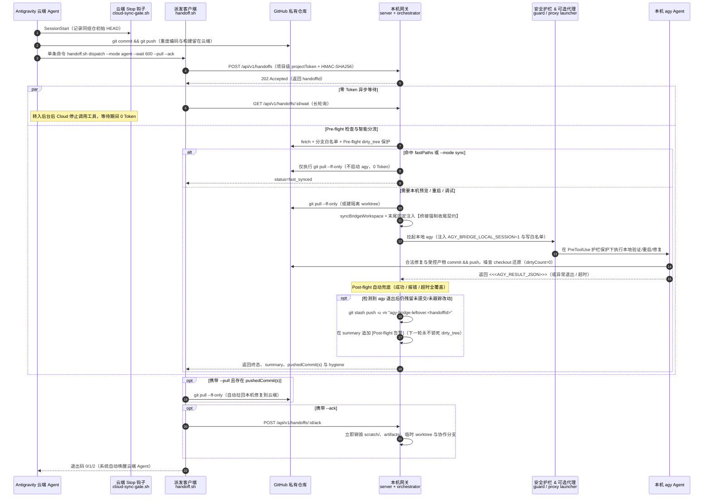

# `agy-cloud-bridge`

[English](./README.md) | **简体中文**

[](https://github.com/guaidashu/agy-cloud-bridge/actions/workflows/ci.yml)
[](./LICENSE)
[](https://nodejs.org/)
[](./package.json)

**零依赖的通用云端 ⇄ 本机 [Antigravity (`agy`)](https://antigravity.google) 协同网关。**

把高强度的 AI 写代码、全仓索引、依赖安装、编译构建和自动化单测全部留在 **Antigravity 云端沙盒**，仅在真正需要本地同步、页面/移动端预览、本地服务热重载或访问内网/硬件环境时，才按需唤醒本机（macOS / Linux）轻量协同。

**大幅减少本机固态硬盘（SSD）的 TBW 擦写损耗，降低发热与风扇负载，延长主力笔记本/Mac 的使用寿命——同时完全保留本地调试与真机预览体验。**

---

## 为什么「云端重计算 + 本机轻同步」能显著护盘、延长电脑寿命？

在个人电脑上全天候本地跑 AI Coding Agent，会持续触发海量高频随机写入（依赖缓存、`node_modules`/Cargo/Gradle/Docker 分层、全仓语义索引、反复编译/单测产物、长对话上下文落盘、浏览器截图与临时文件）。对于板载不可更换 SSD 的现代轻薄本和 Mac，长期高写入放大（Write Amplification）会直接消耗硬盘寿命。

| 典型负载 | 纯本地运行 AI Agent | 使用 `agy-cloud-bridge`（云端 ⇄ 本机） |
| :--- | :--- | :--- |
| **重度编码、重构与全仓检索** | 持续占用本机 CPU 与本地 SSD | **全部在 Antigravity 云端沙盒完成**（本机 0 写入损耗） |
| **依赖安装、编译构建与单测** | 每次任务在本机写入数 GB 缓存与产物 | **云端执行构建与测试**；本机仅拉取极小的 Git 增量提交 |
| **文档 / 内容 / 静态资源改动（`fastPaths`）** | 容易触发完整 Agent 与重构建 | **零 Token `git pull --ff-only`**（毫秒级拉取，不唤醒本地 AI） |
| **本机预览 / 重启服务 / 内网数据库检查** | 全程本地 | **按需精准唤醒**，云端异步零 Token 等待 |
| **临时截图、日志与隔离 Worktree** | 散落在业务仓库和系统 SSD | 集中落盘到 `runsDir` / `worktreesDir`（支持挂载 **`/tmp` 或内存盘**），**收到 `--ack` 立即销毁** |
| **工作区脏文件与残留防死锁** | 人工清理或阻塞下一轮同步 | **Pre-flight 保护用户手改代码** + **Post-flight 自动暂存 AI 残留**（`dirtyCount=0`） |

---

## 核心特性

1. **SSD 友好卸载与全生命周期自动清理**：
   - 支持将 `runtime.runsDir` 与 `runtime.worktreesDir` 配置为 `/tmp` 或内存盘（RAM Disk），把临时截图、测试日志与临时 worktree 的频繁擦写彻底移出主系统 SSD。
   - 云端 `--ack` 后秒级销毁本次运行临时产物、临时 worktree 与远端协作分支，并内置 24 小时定时兜底清扫。
2. **零 Token 异步等待 + 云端 Stop 生命周期守卫**：
   - 双运行时（`python3` / `node`）派发脚本 `handoff.sh` 通过 HTTP 长轮询或 `git ls-remote` 等待，**等待全程 0 大模型 Token 消耗**。
   - 仓内内置 `Stop` 钩子（`cloud-sync-gate.sh`），防止云端改完忘记 `git push` 或忘记触发本地部署；当脚本转入后台等待（`fullyIdle=false`）时自动放行，不浪费 Token。
3. **双端对称收尾契约 + Post-flight 防死锁自动兜底**：
   - **Pre-flight 保护不变**：默认 `dirtyPolicy: "safe-block"`，当检测到用户平时手改未提交改动时直接安全阻断（`phase=dirty_tree`），绝不覆盖或擅自修改用户代码。
   - **Prompt 强制收尾契约**：网关在发给本地 `agy` 的提示词末尾自动注入【桥接强制收尾契约】，要求退出前检查 `git status --porcelain`，将合法修复与构建生成的受控文件（如 `.meta` / lockfile / 生成代码）`git commit && git push` 推回当前分支、用 `git checkout` 还原无意义噪音，断言 `dirtyCount=0`。
   - **Post-flight 自动兜底**：无论本地 `agy` 执行成功、报错还是超时，只要退出后检测到 `git status --porcelain` 非空，自动执行 `git stash push -u -m "agy-bridge-leftover:<handoffId>"` 安全暂存（保留 `.agy-local` 与未变更关联仓的用户手改），并在返回云端的 `summary` 中追加 `[Post-flight 告警]`——既不丢文件，又永远不会把下一轮派发锁死在 `phase=dirty_tree`。
4. **多仓库同组协同（`--group`）**：
   - 云端同时改动并推送多个同组仓库时，只需执行**一次** `handoff.sh dispatch`：网关自动只拉取有新增提交的关联仓，汇总变更清单交给单个本机 `agy` 统一联调，并通过 `--pull` 批量拉回多仓修复。
5. **纵深安全防线**：
   - 项目级独立 `HMAC-SHA256` 令牌（`proj_...`）+ 5 分钟防重放窗口 + Nonce 去重 + 跨项目/跨组越权拦截（`403 FORBIDDEN_PROJECT_SCOPE`）。
   - `enroll` 默认检测 GitHub 公开仓库（`HTTP 200`）并拒绝注入令牌，防止私有配置外泄。
   - 外部隔离工作区 `PreToolUse` 安全护栏（`bridge/agy-bridge-guard.mjs`），拦截敏感目录读取、环境变量导出、高危系统命令、强推及未授权 `git push`。
   - **可选 Fail-Closed 出口代理隔离**（`agy.requireProxy = true` + 自定义启动器模板），适合企业/内网隔离场景。
   - 全链路密钥自动脱敏（`src/redact.js`），支持通过 `security.extraRedactEnvFiles` 追加自定义凭据文件。
6. **零外部依赖 & 跨平台**：
   - 纯 Node.js 18+ 标准库实现，无需 `npm install`，macOS 与 Linux 开箱即用。

---

## 最新架构与全链路时序图



---

## 4 种连接方式任选（零成本到自建全覆盖）

| 方式 | 是否需要公网服务器 / VPS | 适用场景 |
| :--- | :---: | :--- |
| **1. 零服务器模式（`--channel git-ref`）** | **不需要**（仅需私有 Git 仓库） | 个人零成本快速上手、无内网穿透或气隙隔离网络 |
| **2. Cloudflare Tunnel（`cloudflared`）/ Tailscale Funnel / ngrok** | **不需要**（免费托管 HTTPS） | 免买 VPS，一行命令获得实时 HTTPS 长轮询体验 |
| **3. FRP + Nginx 自建穿透** | 需要一台 VPS | 稳定自定义域名、完全自主可控（模板见 `deploy/frp/` 与 `deploy/nginx/`） |
| **4. 可选 Fail-Closed 出口代理隔离** | 可与以上任意方式组合 | 公司/受控网络下强制本地 `agy` 走隔离出口代理（模板见 `deploy/proxy/`） |

---

## 5 分钟快速上手

### 前置条件

- **本机（macOS 或 Linux）**：已安装 Node.js `>= 18`、Git 与 [Antigravity CLI（`agy`）](https://antigravity.google)。
- **私有 Git 仓库**（例如 GitHub 私有仓）：本机与 Antigravity 云端均可正常推送/拉取。

### 第 1 步：克隆并初始化本机网关

```bash
git clone https://github.com/guaidashu/agy-cloud-bridge.git
cd agy-cloud-bridge

# 初始化 ~/.agy-bridge（生成 config.json 与 600 权限全局主密钥 secret.env）
node src/cli.js init

# 可选（推荐，进一步减少主 SSD 擦写损耗）：
# 将临时运行产物与隔离 worktree 目录指向 /tmp 或内存盘
node src/cli.js init \
  --runs-dir /tmp/agy-bridge/runs \
  --worktrees-dir /tmp/agy-bridge/worktrees
```

### 第 2 步：选择暴露网关方式（零服务器模式可跳过）

- **方案 A（零服务器 `git-ref`）**：跳过此步，在第 3 步 `enroll` 时追加 `--channel git-ref` 即可（会自动开启 `gitWatcher.enabled = true`）。
- **方案 B（Cloudflare Tunnel，免费免 VPS）**：
  ```bash
  cloudflared tunnel --url http://127.0.0.1:3190
  # 使用输出的 https://<subdomain>.trycloudflare.com（或你绑定的固定域名）
  ```
- **方案 C（自建 FRP + Nginx）**：参考 [deploy/frp/frpc.toml.example](./deploy/frp/frpc.toml.example) 与 [deploy/nginx/agy-bridge.conf.example](./deploy/nginx/agy-bridge.conf.example)。

### 第 3 步：一键接入任意私有项目

```bash
# HTTPS 模式（Cloudflare Tunnel / FRP / Tailscale Funnel）
node src/cli.js enroll /path/to/your-private-repo \
  --bridge-url https://bridge.example.com \
  --branches "main,feat/*" \
  --fast-paths "^docs/.*\\.md$" \
  --allow-push \
  --context "本地服务由 ./start.sh 启动，监听 3000 端口，健康检查接口 /health。"

# 或 零服务器 git-ref 模式（无需 --bridge-url）
node src/cli.js enroll /path/to/your-private-repo \
  --channel git-ref \
  --branches "main,feat/*" \
  --allow-push
```

回到你的业务仓库，提交推送刚生成的 `.agents/`、`AGENTS.md` 与 `.gitignore`（`.agy-local` 已自动写入 `.gitignore`，只会留在你本机，永不入库）：

```bash
cd /path/to/your-private-repo
git check-ignore -v .agy-local
git add -A && git commit -m "chore: enroll agy-cloud-bridge" && git push
```

### 第 4 步：体检并启动本机网关

```bash
cd /path/to/agy-cloud-bridge

# 一键体检（校验密钥权限、agy CLI、已接入仓库状态与临时目录路径）
node src/cli.js doctor

# 后台启动并查看健康状态
./start.sh
node src/cli.js status
```

如需开机自启与崩溃自动拉起，请按系统复制常驻服务模板：
- **macOS（`launchd`）**：[deploy/launchd/com.agy.bridge.plist.example](./deploy/launchd/com.agy.bridge.plist.example)
- **Linux（`systemd --user`）**：[deploy/systemd/agy-bridge.service.example](./deploy/systemd/agy-bridge.service.example)

### 第 5 步：在 Antigravity 云端直接使用

在 **Antigravity 云端**打开该私有仓库后，云端 Agent 会自动读取仓内 `.agents/rules/cloud-local-bridge.md` 与 `.agents/bridge.json`，**无需配置任何云端环境变量**，完成编码推送后即可自主发起协同：

```bash
bash .agents/skills/cloud-local-handoff/scripts/handoff.sh dispatch \
  --mode agent \
  --task-type preview_and_test \
  --workflow "feature-login" \
  --task "拉取最新改动、重启本地服务并验证 /health 与登录流程；收尾前检查 git status --porcelain，将合法修复或受控生成文件 commit && push 推回当前分支，还原无意义噪音，确保 dirtyCount=0" \
  --wait 600 \
  --pull \
  --ack
```

---

## 进阶：配合内存盘（RAM Disk）实现极致 SSD 护盘

- **Linux**：大多数发行版的 `/tmp` 默认即为 `tmpfs`（内存文件系统），只需在 `~/.agy-bridge/config.json` 配置：
  ```json
  "runtime": {
    "runsDir": "/tmp/agy-bridge/runs",
    "worktreesDir": "/tmp/agy-bridge/worktrees"
  }
  ```
- **macOS**：可创建一个 512 MB 内存盘（如 `/Volumes/AgyRamDisk`）或指向 `/tmp/agy-bridge/...`，将 `runtime.runsDir` 与 `runtime.worktreesDir` 挂载过去。
- 搭配纯文档/内容路径的 `--fast-paths` 和每次派发的 `--ack`，可把本机磁盘写入压到最低。

---

## 可选：开启 Fail-Closed 出口代理隔离

若你的本机位于企业内网环境、要求本地被唤醒的 `agy` 强制走独立出口代理：

1. 复制 [deploy/proxy/agy-proxy-launcher.sh.example](./deploy/proxy/agy-proxy-launcher.sh.example) 到 `~/scripts/agy-proxy-launcher.sh`，并创建 `chmod 600` 的 `~/scripts/proxy.env`。
2. 在 `~/.agy-bridge/config.json` 中开启：
   ```json
   {
     "agy": {
       "requireProxy": true,
       "launcher": "~/scripts/agy-proxy-launcher.sh"
     },
     "security": {
       "deniedReadRoots": ["~/.agy-bridge", "~/.ssh", "~/scripts/proxy.env"],
       "extraRedactEnvFiles": ["~/scripts/proxy.env"]
     }
   }
   ```
3. 执行 `node src/cli.js doctor` 验证代理连通性。

---

## 更多文档与常用维护命令

- **完整项目接入与排障手册**：[docs/PROJECT_ONBOARDING.md](./docs/PROJECT_ONBOARDING.md) | [English Onboarding Guide](./docs/PROJECT_ONBOARDING.en.md)
- **安全策略**：[SECURITY.md](./SECURITY.md)
- **贡献指南**：[CONTRIBUTING.md](./CONTRIBUTING.md)
- **常用维护命令**：
  ```bash
  node src/cli.js project list
  node src/cli.js sync-templates --bridge-url https://bridge.example.com
  node src/cli.js project rotate-token <projectId>
  node src/cli.js cleanup --hours 24
  npm run check && npm test
  ```

## 开源协议

本项目基于 [MIT License](./LICENSE) 开源。
