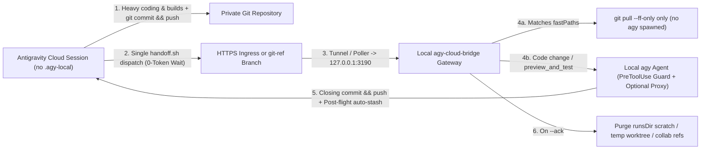

# Cloud ⇄ Local Antigravity (`agy-cloud-bridge`) Project Onboarding Guide

**English** | [简体中文](./PROJECT_ONBOARDING.md)

This guide explains how to onboard **any private Git repository** to `agy-cloud-bridge` with a single command, letting Antigravity Cloud handle heavy AI coding, repository indexing, and builds (protecting your local SSD's TBW lifespan) while waking your local machine (macOS / Linux) only on demand for lightweight sync, preview, restart, or local debugging.

> [!IMPORTANT]
> The local gateway daemon (default port `3190`), public ingress (Cloudflare Tunnel / FRP / Tailscale Funnel, or serverless `git-ref`), and optional egress proxy launcher are **shared across all projects**. Once set up, onboarding additional repositories requires zero changes to gateway or tunnel configuration.

---

## 1. Architecture Overview



---

## 2. One-Time Local Setup

Before enrolling your first repository:

1. Ensure the target repository is a **private Git repository** (`enroll` stores a per-project scoped `projectToken` in `.agents/bridge.json` for zero-env-var Cloud execution and refuses public GitHub repos by default).
2. Initialize and start your local gateway:

```bash
# Recommended: offload ephemeral scratch runs & temporary worktrees to /tmp or a RAM Disk
node /path/to/agy-cloud-bridge/src/cli.js init \
  --runs-dir /tmp/agy-bridge/runs \
  --worktrees-dir /tmp/agy-bridge/worktrees

bash /path/to/agy-cloud-bridge/start.sh
node /path/to/agy-cloud-bridge/src/cli.js status
node /path/to/agy-cloud-bridge/src/cli.js doctor
```

---

## 3. Enrolling a Repository

### Example 1: Web / Service Repo (HTTPS Mode via Cloudflare Tunnel / FRP / Tailscale)

```bash
node /path/to/agy-cloud-bridge/src/cli.js enroll /path/to/your-project \
  --bridge-url https://bridge.example.com \
  --branches "main,feat/*,collab/*" \
  --fast-paths "^docs/.*\\.md$" \
  --allow-push \
  --context "Local service managed by ./start.sh on port 8080; verify /health and key UI pages after code changes."
```

### Example 2: Zero-Server Mode (`git-ref` — No VPS, Domain, or Tunnel Required)

```bash
node /path/to/agy-cloud-bridge/src/cli.js enroll /path/to/your-project \
  --channel git-ref \
  --branches "main,feat/*" \
  --allow-push
```

### Example 3: Multi-Repo Group Coordination (`--group`)

```bash
node /path/to/agy-cloud-bridge/src/cli.js enroll /path/to/my-api --group my-app --bridge-url https://bridge.example.com
node /path/to/agy-cloud-bridge/src/cli.js enroll /path/to/my-web --group my-app --bridge-url https://bridge.example.com
```

### Key `enroll` Options

| Flag | Default / Description |
| :--- | :--- |
| `<repoPath>` | Required. Absolute path to the local Git repository |
| `--id <id>` | Project identifier (defaults to slugified directory name) |
| `--name <name>` | Display name (defaults to `--id`) |
| `--group <group>` | Optional multi-repo collaboration group (single dispatch syncs sibling repos & pulls cross-repo fixes) |
| `--bridge-url <URL>` | Public HTTPS bridge URL (omit when reusing saved URL or using `--channel git-ref`) |
| `--channel http\|git-ref` | Transport channel: `http` (default, real-time long-poll) or `git-ref` (serverless Git refs) |
| `--remote <owner/repo>` | Remote match pattern (auto-detected from `git remote get-url origin`) |
| `--branches "main,feat/*"` | Allowed branch glob allowlist |
| `--fast-paths "regex1,regex2"` | Regex list for zero-token `git pull` without launching local `agy` |
| `--local-marker <relPath>` | Gitignored local marker file (default `.agy-local`) |
| `--dirty-policy safe-block\|worktree` | Pre-flight policy when local repo has uncommitted changes (`safe-block` protects edits; `worktree` uses an isolated temporary worktree) |
| `--allow-push` / `--no-push` | Whether local `agy` is allowed to `git push` fixes (default: enabled) |
| `--max-rounds <n>` | Max Cloud ⇄ Local round-trips per `--workflow` before circuit breaker trips (default `5`) |
| `--context "<text>"` | Local startup, port, and verification instructions injected into workspace rules |
| `--rotate-token` | Rotate an enrolled project's scoped `projectToken` |
| `--allow-public-repo` | Override public-repo safety check (**not recommended**) |

---

## 4. Injected Files & Dual-End Hygiene Guarantees

| File Path | Committed to Git? | Purpose |
| :--- | :---: | :--- |
| `.agents/bridge.json` | ✅ Yes | Project-scoped `bridgeUrl`, `projectId`, `defaultChannel`, `projectToken`, `group`, and `localMarkerFile` |
| `.agents/hooks.json` & `.agents/hooks/cloud-sync-gate.sh` | ✅ Yes | Cloud `SessionStart` / `Stop` gate preventing forgotten pushes/deploys (instant no-op on local machine) |
| `.agents/rules/cloud-local-bridge.md` | ✅ Yes | **Dual-end symmetric rules** (Cloud push+dispatch closure + Local commit/push & `dirtyCount=0` assertion) |
| `.agents/skills/cloud-local-handoff/SKILL.md` | ✅ Yes | Repo-local handoff instructions and exit-code guide |
| `.agents/skills/cloud-local-handoff/scripts/handoff.sh` | ✅ Yes | Zero-env-var dual-runtime (`python3` / `node`) dispatch client |
| `AGENTS.md` | ✅ Yes | Idempotent `<!-- AGY_CLOUD_BRIDGE_START -->` pointer section |
| `.gitignore` | ✅ Yes | Idempotently adds `.agy-local` (or custom `--local-marker`) |
| `.agy-local` | ❌ **Local only** | Gitignored marker distinguishing local machine from Cloud sandbox |

### Anti-Recursion & Pre/Post-flight Protection

1. **Three-layer anti-recursion**: `AGY_BRIDGE_LOCAL_SESSION=1` → `.agy-local` marker file → `~/.agy-bridge/config.json` local path check (override with `--force-local` only for local self-tests).
2. **Pre-flight `dirty_tree` protection**: Never overwrites or stashes pre-existing manual uncommitted work (`phase=dirty_tree`, exit code `2`).
3. **Post-flight anti-deadlock auto-stash**: After any local `agy` run exits (success, error, or timeout), any newly created leftover dirty files are stashed via `git stash push -u -m "agy-bridge-leftover:<handoffId>"` (keeping `.agy-local` intact and skipping unchanged peer repos that had pre-existing user WIP) with a `[Post-flight 告警]` warning appended to `summary`.

---

## 5. Post-Enroll Verification (3 Steps)

```bash
# 1. Confirm .agy-local is ignored, then commit & push
cd /path/to/your-project
git check-ignore -v .agy-local
git add -A && git commit -m "chore(bridge): enroll agy-cloud-bridge" && git push -u origin main

# 2. Run doctor & verify local anti-recursion guards
node /path/to/agy-cloud-bridge/src/cli.js doctor
bash .agents/skills/cloud-local-handoff/scripts/handoff.sh dispatch --task "guard check" --json
AGY_HANDOFF_RUNTIME=node bash .agents/skills/cloud-local-handoff/scripts/handoff.sh dispatch --task "guard check node" --json

# 3. Optional local loopback smoke test (--force-local)
bash .agents/skills/cloud-local-handoff/scripts/handoff.sh dispatch \
  --force-local --mode sync --task "smoke sync" --wait 30 --ack --json
```

---

## 6. Troubleshooting

| Symptom / Status | Cause & Resolution |
| :--- | :--- |
| `skipped_local_marker_present` | Expected safety guard when running inside your local repo; add `--force-local` only for intentional local self-tests |
| `blocked` (`phase: dirty_tree`) | Pre-flight detected uncommitted manual work locally; commit/stash it or switch the project to `--dirty-policy worktree` |
| `[Post-flight 告警]` in `summary` | Local `agy` exited with leftover dirty files; the gateway safely stashed them under `agy-bridge-leftover:<handoffId>` so future rounds stay unblocked (`git stash list` to inspect) |
| `HTTP 401` | `.agents/bridge.json` token out of sync with `~/.agy-bridge/config.json` (commit/push after `rotate-token` and pull in Cloud) |
| `HTTP 403 FORBIDDEN_PROJECT_SCOPE` | Project A's token attempted to dispatch/inspect an unrelated Project B; assign the same `--group` for multi-repo collaboration |
| `MAX_ROUNDS_EXCEEDED` | Workflow hit `maxRounds` circuit breaker (default 5); inspect logs and start a fresh `--workflow` ID |
| `doctor` runner check failed | Ensure `agy --help` works locally; if `agy.requireProxy=true`, verify your proxy launcher `--check` passes |
