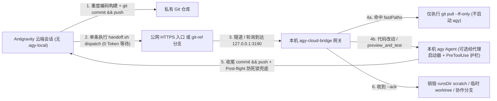

# 云端 ⇄ 本机 Antigravity（`agy-cloud-bridge`）通用项目接入指南

[English](./PROJECT_ONBOARDING.en.md) | **简体中文**

本文档说明如何为**任意新的私有 Git 仓库**一键接入 `agy-cloud-bridge` 协同能力，让 Antigravity 云端 Agent 承担重度编码、全仓索引与构建测试（保护本机 SSD 寿命），并在提交推送代码后按需通知本机（macOS / Linux）自动拉取代码、重启部署、预览调试或修 Bug，结束后自动清理临时产物并保持工作区清零。

> [!IMPORTANT]
> 本机常驻网关（默认端口 `3190`）、公网入口（Cloudflare Tunnel / FRP / Tailscale Funnel，或零服务器 `git-ref` 模式）以及可选出口代理启动器**全项目共享、一次配置即可永久复用**；后续新增任意项目，**不需要再修改网关代码或穿透配置**。

---

## 1. 能力概览与整体架构



---

## 2. 前置条件（首次搭好后永久复用）

接入新项目前，确认以下基础条件就绪：

1. **目标仓库为 Git 仓库且建议为私有仓库**：`enroll` 会将独立项目令牌 `projectToken` 写入仓库内 `.agents/bridge.json`（实现云端零环境变量调用），并自动检测 GitHub 公开性，若检测到公开仓库会默认拒绝接入以防令牌外泄。
2. **本机网关已初始化并运行正常**：

```bash
node /path/to/agy-cloud-bridge/src/cli.js status
node /path/to/agy-cloud-bridge/src/cli.js doctor
```

- 如网关尚未初始化或未启动：

```bash
node /path/to/agy-cloud-bridge/src/cli.js init \
  --runs-dir /tmp/agy-bridge/runs \
  --worktrees-dir /tmp/agy-bridge/worktrees
bash /path/to/agy-cloud-bridge/start.sh
```

---

## 3. 新项目快速接入（两种方式）

### 方式 A：直接对本机 Antigravity 说一句话

在本机 Antigravity 会话中粘贴下面模板并替换占位内容：

> 请用 `/path/to/agy-cloud-bridge/src/cli.js enroll` 把项目 `<项目本地绝对路径>` 接入云端 ⇄ 本机协同：
> - 网关地址用 `https://bridge.example.com`（若使用零服务器模式改为 `--channel git-ref`）
> - 允许推送分支 `main,feat/*`，开启 `--allow-push`
> - 仅文档/静态内容快速同步正则（可选）：`^docs/.*\.md$`
> - 本地环境说明（`--context`）：说明本地如何启动/重启服务、监听端口与健康检查接口
> 接入后运行 `doctor`，并把 `.gitignore`、`.agents/` 与 `AGENTS.md` 提交推送到远端。

### 方式 B：命令行一条指令接入

#### 示例 1：Web / 前后端服务项目（HTTPS 模式完整推荐参数）

```bash
node /path/to/agy-cloud-bridge/src/cli.js enroll /path/to/your-project \
  --bridge-url https://bridge.example.com \
  --branches "main,feat/*,collab/*" \
  --fast-paths "^docs/.*\\.md$" \
  --allow-push \
  --context "本地服务由 ./start.sh 管理（端口 8080）；仅改 docs/ 无需重启，改动服务端或前端源码需重启并验证 /health 与核心页面。"
```

#### 示例 2：零服务器模式（无需域名、VPS 或内网穿透）

```bash
node /path/to/agy-cloud-bridge/src/cli.js enroll /path/to/your-project \
  --channel git-ref \
  --branches "main,feat/*" \
  --allow-push
```

#### 示例 3：多仓库同组协同（前后端联动）

```bash
node /path/to/agy-cloud-bridge/src/cli.js enroll /path/to/my-api --group my-app --bridge-url https://bridge.example.com
node /path/to/agy-cloud-bridge/src/cli.js enroll /path/to/my-web --group my-app --bridge-url https://bridge.example.com
```

#### 常用 `enroll` 参数说明

| 参数 | 默认值 / 说明 |
| :--- | :--- |
| `<repoPath>` | 必填，目标项目在本机上的 Git 仓库路径 |
| `--id <id>` | 项目唯一标识（默认取目录名转小写 slug） |
| `--name <name>` | 项目显示名称（默认同 `--id`） |
| `--group <group>` | 可选，多仓库协同分组名（同组仓库支持单次派发联动同步与跨仓 `--pull`） |
| `--bridge-url <URL>` | 公网网关地址（如 `https://bridge.example.com`），复用已有值或 `git-ref` 模式时可省略 |
| `--channel http\|git-ref` | 协同通道：默认 `http`（实时长轮询），`git-ref` 为零服务器 Git 分支通道 |
| `--remote <owner/repo>` | 远端仓库匹配规则（默认自动读取 `git remote get-url origin`） |
| `--branches "main,feat/*"` | 允许云端协同触发的分支白名单，逗号分隔 |
| `--fast-paths "regex1,regex2"` | 命中的变更文件只执行零 Token `git pull`，不唤醒本地 `agy` |
| `--local-marker <relPath>` | 本机环境标记文件名（默认 `.agy-local`，自动写入 `.gitignore`） |
| `--dirty-policy safe-block\|worktree` | 本地有未提交改动时的 Pre-flight 策略：`safe-block` 安全阻断（默认），`worktree` 自动开临时工作树 |
| `--allow-push` / `--no-push` | 是否允许被唤醒的本地 `agy` 提交并 `git push` 修复（默认允许） |
| `--max-rounds <n>` | 同一 `workflow` 云端⇄本机最大往返轮次熔断值（默认 `5`） |
| `--context "<text>"` | 注入给云端/本机规则的项目启动、端口与验证约定说明 |
| `--rotate-token` | 若项目已接入，强制轮换该项目独立的 `projectToken` |
| `--allow-public-repo` | 显式允许接入公开仓库（**不推荐**，令牌将存在于仓库配置中） |

---

## 4. `enroll` 自动注入的文件与双端对称守则

执行 `enroll` 后，会在目标仓库自动生成或更新以下内容：

| 文件路径 | 是否入库 Git | 作用说明 |
| :--- | :---: | :--- |
| `.agents/bridge.json` | ✅ 提交推送 | 记录 `bridgeUrl`、`projectId`、`defaultChannel`、项目隔离令牌 `projectToken`、`group` 与 `localMarkerFile` |
| `.agents/hooks.json` & `.agents/hooks/cloud-sync-gate.sh` | ✅ 提交推送 | 云端 `SessionStart` / `Stop` 生命周期门禁（防忘记 push 或漏派发；本机自动 no-op） |
| `.agents/rules/cloud-local-bridge.md` | ✅ 提交推送 | **云端 ⇄ 本机双端对称协同规则**（云端推代码部署闭环 + 本机退出前提交推送并断言 `dirtyCount=0`） |
| `.agents/skills/cloud-local-handoff/SKILL.md` | ✅ 提交推送 | 云端 Agent 调用 `handoff.sh` 的标准指南与退出码说明 |
| `.agents/skills/cloud-local-handoff/scripts/handoff.sh` | ✅ 提交推送 | 零环境变量双运行时（`python3` / `node`）派发客户端 |
| `AGENTS.md` | ✅ 提交推送 | 追加或幂等更新 `<!-- AGY_CLOUD_BRIDGE_START -->` 协同入口说明 |
| `.gitignore` | ✅ 提交推送 | 幂等追加 `.agy-local`（或自定义的 `--local-marker` 路径） |
| `.agy-local` | ❌ **仅存本机** | 本机环境标记文件；因被 `.gitignore` 忽略，永远不会被推送到远端 Git |

### 三层防误触防递归 + 双层工作区卫生保护

1. **三层防误触防递归**：`AGY_BRIDGE_LOCAL_SESSION=1` 环境变量 → 仓库根目录 `.agy-local` 标记文件 → 本机 `~/.agy-bridge/config.json` 已登记路径兜底（本地调试模拟云端可传 `--force-local`）。
2. **Pre-flight 保护用户手改**：任务启动前若存在未提交修改（`dirtyPolicy=safe-block`），直接阻断返回 `phase=dirty_tree`（退出码 `2`），保护用户手工修改不被覆盖。
3. **Post-flight 自动防死锁**：无论本地 `agy` 执行成功、报错还是超时，只要退出后检测到 `git status --porcelain` 非空，网关会自动执行 `git stash push -u -m "agy-bridge-leftover:<handoffId>"` 安全暂存（保留 `.agy-local` 及未变更关联仓的原有用户手改），并在返回云端的 `summary` 中追加 `[Post-flight 告警]`，确保既不丢文件、也不会把下一轮派发锁死在 `phase=dirty_tree`。

---

## 5. 接入后的 3 步提交与验证清单

### 第 1 步：确认 `.agy-local` 未被暂存并提交推送

```bash
cd /path/to/your-project
git check-ignore -v .agy-local
git status --short
git add -A
git commit -m "chore(bridge): 接入 agy-cloud-bridge 云端本地协同"
git push -u origin main
```

### 第 2 步：运行体检与本地守卫检查

```bash
# 1. 全局体检，确认目标项目显示 local-token:ok,repo-bridge:synced,local-marker:ok
node /path/to/agy-cloud-bridge/src/cli.js doctor

# 2. 验证本地误触发守卫（Python 与 Node 运行时均应返回 skipped_local_marker_present）
bash .agents/skills/cloud-local-handoff/scripts/handoff.sh dispatch --task "guard check" --json
AGY_HANDOFF_RUNTIME=node bash .agents/skills/cloud-local-handoff/scripts/handoff.sh dispatch --task "guard check node" --json

# 3. 验证公网域名健康检查（HTTPS 模式）
bash .agents/skills/cloud-local-handoff/scripts/handoff.sh health
```

### 第 3 步：（可选）在本机用 `--force-local` 演练完整云端回环

```bash
# 先测试快同链路（mode=sync）
bash .agents/skills/cloud-local-handoff/scripts/handoff.sh dispatch \
  --force-local --mode sync --task "自测同步链路" --wait 30 --ack --json

# 再测试真实拉起本机 agy 执行验证（mode=agent）
bash .agents/skills/cloud-local-handoff/scripts/handoff.sh dispatch \
  --force-local --mode agent --task-type preview_and_test \
  --workflow smoke-1 \
  --task "检查仓库状态并验证本地服务健康接口，只读验证不要改动业务文件" \
  --wait 300 --pull --ack
```

---

## 6. 日常维护与故障排查速查

### 常用维护命令

```bash
# 查看已接入项目列表
node /path/to/agy-cloud-bridge/src/cli.js project list

# 网关升级模板或更换公网域名后，批量同步到所有已接入项目（记得随后在各仓库 push）
node /path/to/agy-cloud-bridge/src/cli.js sync-templates --bridge-url https://bridge.example.com

# 轮换某个项目的独立令牌（会同步写入目标仓库 .agents/bridge.json，记得 commit & push）
node /path/to/agy-cloud-bridge/src/cli.js project rotate-token <projectId>

# 停止 / 重启 / 手动清扫过期运行目录
bash /path/to/agy-cloud-bridge/stop.sh
bash /path/to/agy-cloud-bridge/start.sh
node /path/to/agy-cloud-bridge/src/cli.js cleanup --hours 24
```

### 常见报错排查

| 现象 / 返回状态 | 原因与处理方式 |
| :--- | :--- |
| `skipped_local_marker_present` | 正常保护行为，说明当前位于带 `.agy-local` 的本机仓库中；若确实要在本机模拟云端触发，追加 `--force-local` |
| `blocked` (`phase: dirty_tree`) | Pre-flight 检测到用户平时手改未提交改动，网关为防覆盖拒绝同步；先处理本地改动，或按需改配 `--dirty-policy worktree` |
| `summary` 含 `[Post-flight 告警]` | 本地 `agy` 退出时残留了未提交文件，网关已自动 `git stash push -u -m "agy-bridge-leftover:<handoffId>"` 暂存避免死锁；本机可通过 `git stash list` 查看，合法改动 `git stash pop` 提交，噪音 `git stash drop` |
| `HTTP 401` | 仓库 `.agents/bridge.json` 中的 `projectToken` 与 `~/.agy-bridge/config.json` 不一致（常见于轮换令牌后未 `git push` 或云端未 `git pull`） |
| `HTTP 403 FORBIDDEN_PROJECT_SCOPE` | 尝试用 A 项目的令牌去调度/查询非同组的 B 项目被拒绝；如需多仓联动，给两者配置相同的 `--group` |
| `MAX_ROUNDS_EXCEEDED` | 同一个 `--workflow` 往返次数达到 `maxRounds` 熔断上限（默认 5 轮）；排查后换新的 `--workflow` 名称继续 |
| `enroll` 拒绝公开仓库 | 检测到 GitHub 仓库公网可见（HTTP 200）；转为私有仓库后再执行 `enroll` |
| `doctor` 校验失败 | 检查本机 `agy --help` 是否可执行；若开启了 `agy.requireProxy=true`，检查你的代理启动器 `--check` 与代理凭据配置 |

---

## 7. 安全红线

1. **禁止将 `.agents/bridge.json` 推入公开仓库**：只要仓库内包含项目级 `projectToken`，必须保持为私有仓库；一旦疑似外泄，立即执行 `project rotate-token <projectId>`。
2. **禁止泄露敏感凭据文件**：切勿在日志、提交记录或对话输出中打印 `~/.agy-bridge/secret.env`、自定义代理 `.env` 或 `.agents/bridge.json` 中的明文令牌；可在 `security.extraRedactEnvFiles` 配置额外需自动脱敏的 `.env` 文件。
3. **可选代理隔离模式保持 Fail-Closed**：若你的网络环境要求本地 `agy` 走隔离出口代理，请开启 `agy.requireProxy = true` 并配置 `agy.launcher`，同时在启动器中保留 `NO_PROXY=localhost,127.0.0.1,::1` 以保障本地服务预览不受影响。
